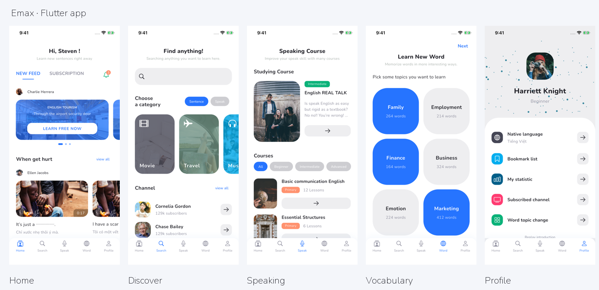
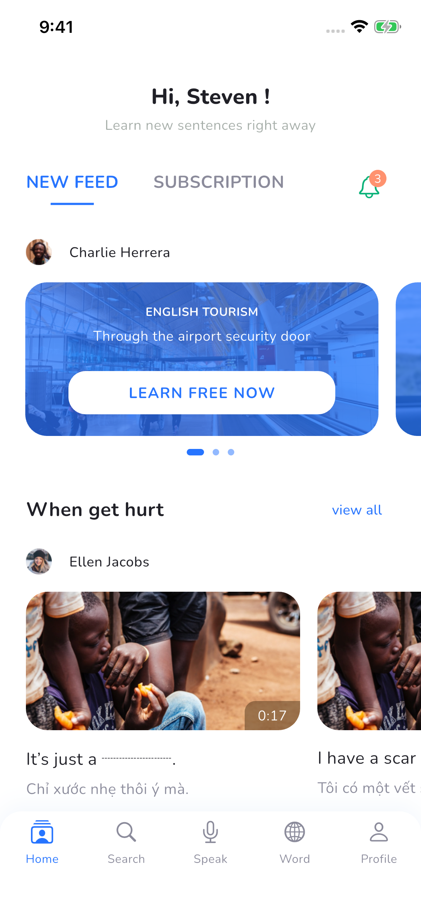
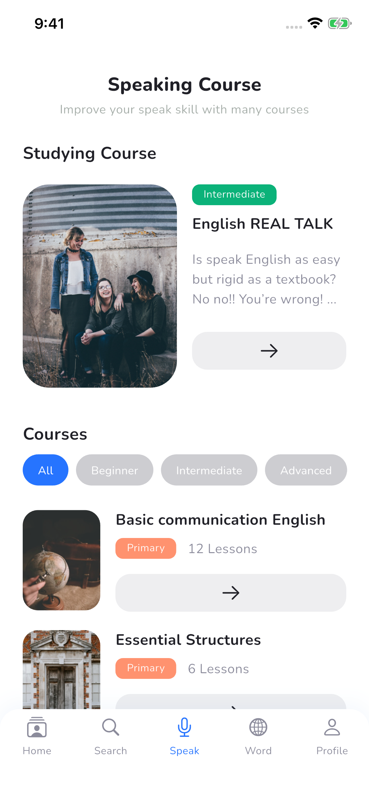
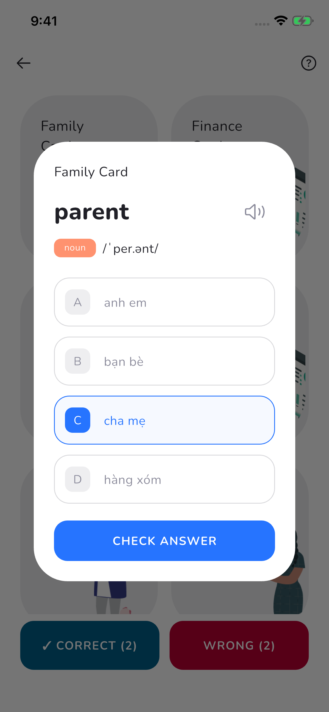

# Emax · Flutter 英语学习 App

根据 Pixso 当前打开的 **Emax / Emax** 设计页开发。覆盖原稿的 **34 个界面与状态**，另补充收藏列表、学习统计、订阅列表、频道列表和通知页。界面沿用原稿的蓝色主题、圆角卡片、Nunito 字体及课程插画，内容保留英文与越南语示例。

这是可以运行、浏览和完成学习流程的本地演示项目。学习数据保存在设备上，不依赖业务服务器。

## 主要界面

以下图片均来自本项目在 **iPhone 16e / iOS 26.0 模拟器**中的实际运行截图，原始分辨率为 1170 × 2532。



首页提供情景学习入口，口语课程以对话串联听力与练习，单词卡通过答题记录正确词和错词。

| 学习首页 | 口语课程 | 单词答题 |
| --- | --- | --- |
|  |  |  |

**[全部界面截图与 Pixso 节点对应表](docs/SCREENSHOTS.md)** · **[架构与实现说明](docs/ARCHITECTURE.md)** · **[验证记录](docs/VALIDATION.md)**

## 启动

开发环境使用 Flutter **3.41.6**、Dart **3.11.4**。已生成 iOS、Android、Web 工程。

```bash
flutter pub get
flutter devices
flutter run
```

也可以指定目标：

```bash
flutter run -d <设备ID>
flutter run -d chrome
flutter build web --release
```

首次打开依次进入启动页和三页引导。登录页可使用 **Explore demo** 直接体验；表单方式填写有效邮箱和至少 6 位密码，注册页还会校验两次密码一致性。密码不会保存或发送。

## 可以体验的流程

- **首页学习**：轮播推荐 → 情景文章 → 单词释义、句子朗读、播放速度、翻译切换 → 收藏与订阅 → 记忆测试。
- **搜索与发现**：输入关键词筛选内置句子，浏览 Movie / Travel / Music 分类、频道详情并订阅。
- **口语学习**：课程列表 → 课程详情 → 出租车对话 → 逐句英文朗读、字幕切换 → 口语演示 → 成绩页。
- **词汇学习**：选择主题 → 点击单词卡 → 选择释义 → 检查答案 → 正确/错误列表 → 重新答对后移出错词列表 → 当前词组全部答对后升级。
- **个人资料**：保存母语偏好，查看收藏、订阅、最高测试分和学习记录。

测试含 5 道题、3 种题型：句子填空、含义选择、图片情境选择。计分来自实际选择，并保存历史最高分；60 秒倒计时结束会结算。

## 项目结构

```text
Emax/
├── lib/
│   ├── main.dart                  # 初始化本地存储、系统栏与应用
│   ├── app.dart                   # 主题与命名路由
│   ├── core/
│   │   ├── app_store.dart         # ChangeNotifier、InheritedNotifier、本地持久化
│   │   ├── speech_player.dart     # 系统英文 TTS 朗读与停止
│   │   └── ui.dart                # 通用按钮、导航、标签、头像和视觉常量
│   ├── data/catalog.dart          # 课程/句子/词卡模型、演示内容、34 个设计路由
│   └── features/
│       ├── auth/                  # 启动、引导、登录、注册
│       ├── home/                  # 首页、文章、记忆测试
│       ├── search/                # 搜索、分类、频道
│       ├── speaking/              # 课程、对话、听力、练习与成绩
│       ├── vocabulary/            # 主题、词卡、正确/错误复习列表
│       └── profile/               # 资料、语言与辅助列表
├── assets/
│   ├── images/                    # 从 Pixso 导出的实际使用素材
│   └── fonts/                     # Nunito 字体与 OFL 许可证
├── design/reference/              # 34 张 Pixso 原稿 PNG
├── docs/screenshots/              # App 实际运行截图
├── test/app_test.dart             # 状态持久化、全页面渲染、主流程测试
├── test_driver/                   # 仅用于模拟器验证的独立入口与截图脚本
├── scripts/capture_screenshots.sh # 一键重拍 iOS 截图并验证交互
└── ios/ · android/ · web/         # Flutter 平台工程
```

采用按功能分组的轻量架构：页面使用 `AppScope` 读取 `AppStore`；用户操作更新状态，通过 `SharedPreferences` 持久化，并通知依赖页面刷新。局部选项、输入和播放状态由对应页面的 `State` 管理。详细的数据流和扩展位置见 [架构说明](docs/ARCHITECTURE.md)。

## 验证与重新截图

```bash
flutter analyze
flutter test
# 先启动一个 iOS 模拟器，再运行：
./scripts/capture_screenshots.sh
# 多设备时可以明确指定已启动的模拟器 UDID：
./scripts/capture_screenshots.sh <模拟器UDID>
```

截图入口使用隔离的内存演示数据，展示已答对词与错词，不会覆盖正常入口保存的个人学习记录。截图后请使用 `flutter run -t lib/main.dart` 启动正常版本。

## 演示范围

- 登录/注册为本地表单流程，第三方登录按钮会提示尚未接入。没有真实账号、支付或云端同步。
- 原稿没有附带视频文件。文章媒体区展示设计封面，播放按钮朗读示例句子；听力与词卡发音调用设备的英文 TTS。设备需要支持英文语音。
- 口语按钮用于演示练习进度和结果，**没有录音、语音识别或真实发音评分**；页面标注 `Practice demo`。
- 当前内置 5 条情景句子、6 张 Family / Finance / Marketing 词卡和一组出租车对话。其余课程与分类复用演示内容；原稿的总词数、订阅数属于展示数据。
- 母语选择保存的是偏好，不会自动翻译内置内容。分享操作复制课程摘要到剪贴板。
- iOS 已实测；Web 已进行构建验证；Android 生成了工程，但本次未进行 Android 模拟器或真机验证。

## 代码精简

已将逐层绝对定位的导出代码整理为语义化 Flutter 页面与共用组件，移除未使用的生成文件、重复图片和默认计数器示例。运行时只引入本地存储、系统朗读和 Cupertino 图标依赖；截图驱动仅位于开发依赖与测试入口中。
