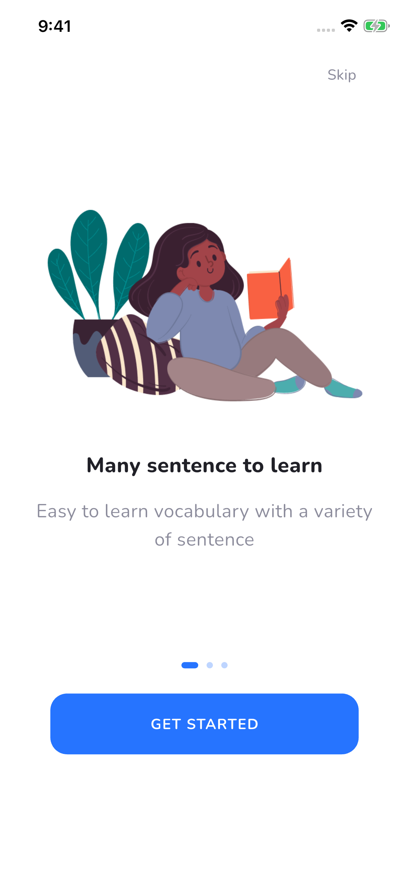
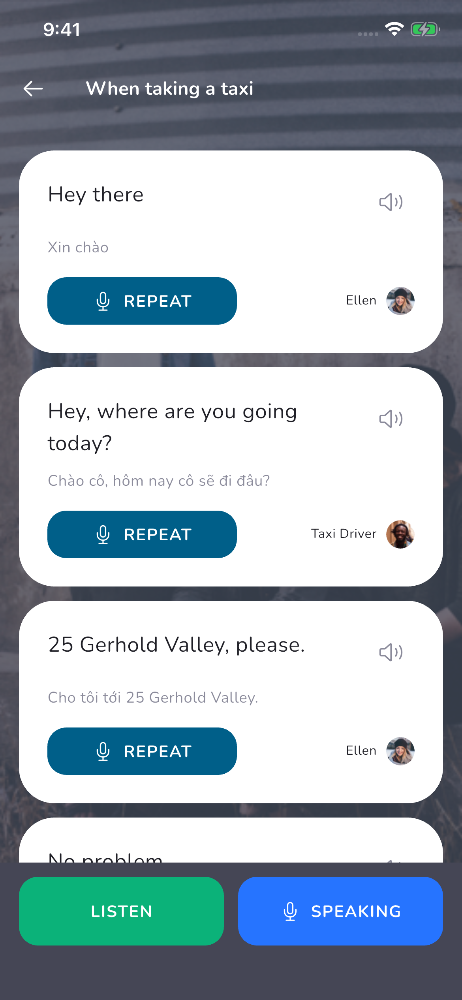
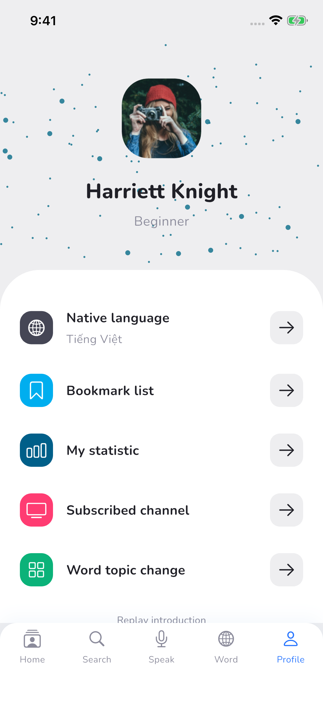

# 全部界面截图

共 **39 张 App 实际运行截图**：34 个 Pixso 设计界面/状态，加 5 个辅助页面。另保留 34 张原稿截图作为对照。

运行环境：iPhone 16e，iOS 26.0，390 × 844 逻辑尺寸，3 倍像素比例。PNG 原始尺寸为 1170 × 2532。

截图使用隔离的演示数据（2 个正确词、2 个错词）。测试题与词卡截图展示已选中答案；统计和收藏可能展示空状态，这是本地数据的真实状态。

## Pixso 设计对应界面

| 界面 | Flutter 路由 | App 截图 | Pixso 原稿 | 节点 |
| --- | --- | --- | --- | --- |
| 启动页 | `/splash` | [查看](screenshots/00_1_splash.png) | [对照](../design/reference/00.1_-_Splash.png) | `0:5158` |
| 引导：情景句子 | `/onboarding/0` | [查看](screenshots/00_2_onboarding_sentences.png) | [对照](../design/reference/00.2_-_Onboarding_1.png) | `0:5160` |
| 引导：口语课程 | `/onboarding/1` | [查看](screenshots/00_3_onboarding_speaking.png) | [对照](../design/reference/00.3_-_Onboarding_2.png) | `0:5413` |
| 引导：单词卡 | `/onboarding/2` | [查看](screenshots/00_4_onboarding_vocabulary.png) | [对照](../design/reference/00.4_-_Onboarding_3.png) | `0:5681` |
| 注册 | `/signup` | [查看](screenshots/00_5_sign_up.png) | [对照](../design/reference/00.5_-_Sign_up.png) | `0:5949` |
| 登录 | `/signin` | [查看](screenshots/00_6_sign_in.png) | [对照](../design/reference/00.6_-_Sign_in.png) | `0:5995` |
| 学习首页 | `/home` | [查看](screenshots/01_home.png) | [对照](../design/reference/01_-_Home.png) | `0:5095` |
| 文章学习 | `/post` | [查看](screenshots/02_1_post.png) | [对照](../design/reference/02.1_-_Home_-_Post.png) | `0:4968` |
| 文章：词典提示 | `/post/dictionary` | [查看](screenshots/02_2_post_dictionary.png) | [对照](../design/reference/02.2_-_Home_-_Post.png) | `0:4901` |
| 文章：重复状态 | `/post/repeat` | [查看](screenshots/02_3_post_repeat.png) | [对照](../design/reference/02.3_-_Home_-_Post.png) | `0:4837` |
| 文章：口语练习入口 | `/post/practice` | [查看](screenshots/02_4_post_practice.png) | [对照](../design/reference/02.4_-_Home_-_Post.png) | `0:4711` |
| 测试：句子填空 | `/quiz/0` | [查看](screenshots/03_1_test_sentence.png) | [对照](../design/reference/03.1_-_Test_a.png) | `0:4676` |
| 测试：词义选择 | `/quiz/1` | [查看](screenshots/03_2_test_meaning.png) | [对照](../design/reference/03.2_-_Test_b.png) | `0:4646` |
| 测试：情境选择 | `/quiz/2` | [查看](screenshots/03_3_test_listening.png) | [对照](../design/reference/03.3_-_Test_c.png) | `0:4606` |
| 测试：普通成绩 | `/result/test/60` | [查看](screenshots/03_4_test_score.png) | [对照](../design/reference/03.4_-_Test_score.png) | `0:4589` |
| 测试：满分成绩 | `/result/test/100` | [查看](screenshots/03_5_test_perfect.png) | [对照](../design/reference/03.5_-_Test_score.png) | `0:4433` |
| 搜索首页 | `/search` | [查看](screenshots/05_1_search.png) | [对照](../design/reference/05.1_-_Search.png) | `0:4389` |
| 分类与频道 | `/category/Movie` | [查看](screenshots/05_2_search_movie.png) | [对照](../design/reference/05.2_-_Search_-_Movie.png) | `0:4326` |
| 频道详情 | `/channel` | [查看](screenshots/05_3_channel.png) | [对照](../design/reference/05.3_-_Search_-_Channel.png) | `0:4235` |
| 口语课程首页 | `/speak` | [查看](screenshots/06_1_speaking.png) | [对照](../design/reference/06.1_-_Speak.png) | `0:720` |
| 课程详情 | `/course` | [查看](screenshots/06_2_course.png) | [对照](../design/reference/06.2_-_Course.png) | `0:677` |
| 对话学习 | `/conversation` | [查看](screenshots/06_3_conversation.png) | [对照](../design/reference/06.3_-_Course_-_Conversation.png) | `0:611` |
| 听力练习 | `/listen` | [查看](screenshots/06_4_listen.png) | [对照](../design/reference/06.4_-_Course_-_Listen.png) | `0:566` |
| 口语演示 | `/speaking` | [查看](screenshots/06_5_speaking_practice.png) | [对照](../design/reference/06.5_-_Course_-_Speaking.png) | `0:529` |
| 口语：普通成绩 | `/result/speaking/75` | [查看](screenshots/06_6_speaking_score.png) | [对照](../design/reference/06.6_-_Course_-_Score.png) | `0:512` |
| 口语：满分成绩 | `/result/speaking/100` | [查看](screenshots/06_7_speaking_perfect.png) | [对照](../design/reference/06.7_-_Course_-_Score.png) | `0:2` |
| 单词主题选择 | `/topics` | [查看](screenshots/07_1_topics.png) | [对照](../design/reference/07.1_-_Word.png) | `0:777` |
| 单词卡列表 | `/words` | [查看](screenshots/07_1_word_board.png) | [对照](../design/reference/07.1_-_Word_Copy.png) | `0:1021` |
| 单词卡答题 | `/words/card` | [查看](screenshots/07_2_word_card.png) | [对照](../design/reference/07.2_-_Word_-_Card.png) | `0:3556` |
| 答对词列表 | `/words/correct` | [查看](screenshots/07_3_correct_words.png) | [对照](../design/reference/07.3_-_Word_-_Correct.png) | `0:1643` |
| 错词复习列表 | `/words/wrong` | [查看](screenshots/07_4_wrong_words.png) | [对照](../design/reference/07.4_-_Word_-_Wrong.png) | `0:2501` |
| 升级结果 | `/level-up` | [查看](screenshots/07_5_level_up.png) | [对照](../design/reference/07.5_-_Course_-_Level_up.png) | `0:158` |
| 个人资料 | `/profile` | [查看](screenshots/08_1_profile.png) | [对照](../design/reference/08.1_-_Profile.png) | `0:837` |
| 母语选择 | `/language` | [查看](screenshots/08_2_native_language.png) | [对照](../design/reference/08.2_-_Profile_-_Native_Language.png) | `0:990` |

## 补充的功能页面

| 界面 | 路由 | 截图 |
| --- | --- | --- |
| 收藏列表 | `/bookmarks` | [查看](screenshots/09_1_bookmarks.png) |
| 学习统计 | `/statistics` | [查看](screenshots/09_2_statistics.png) |
| 订阅频道 | `/subscriptions` | [查看](screenshots/09_3_subscriptions.png) |
| 频道列表 | `/channels` | [查看](screenshots/09_4_channels.png) |
| 通知中心 | `/notifications` | [查看](screenshots/09_5_notifications.png) |

## 关键流程截图

### 引导与入口

### 口语对话

### 单词答题

### 个人资料

[返回项目说明](../README.md)
